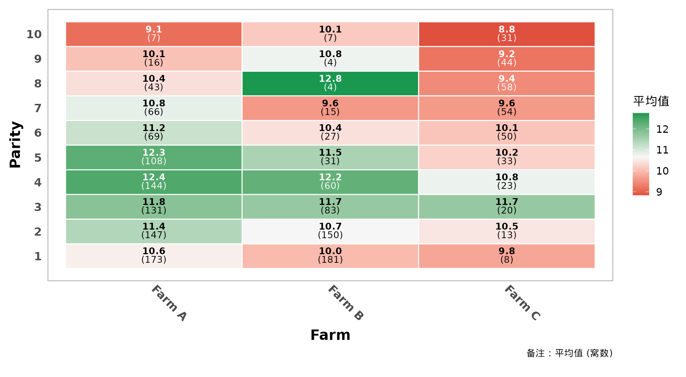
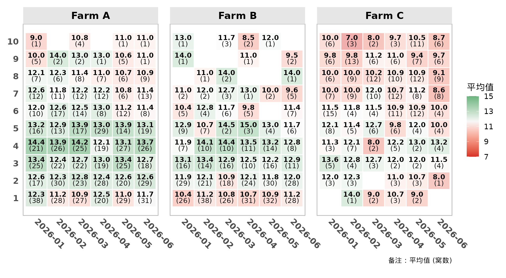
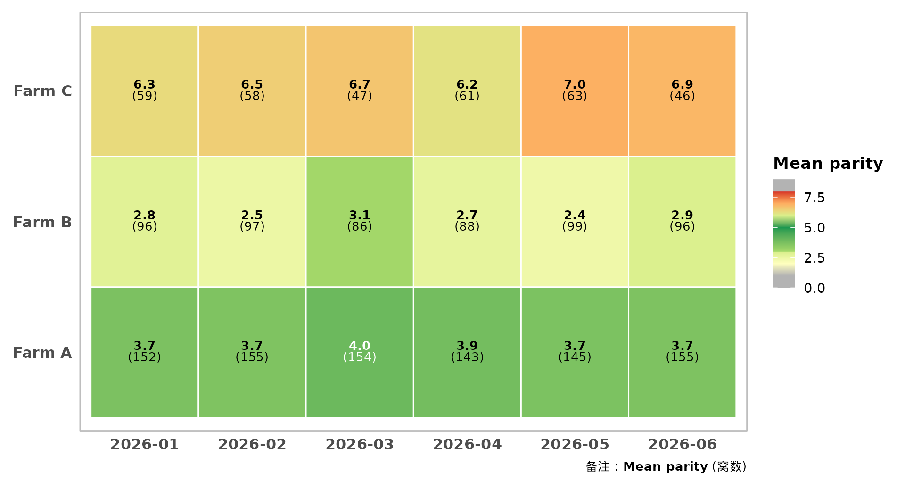
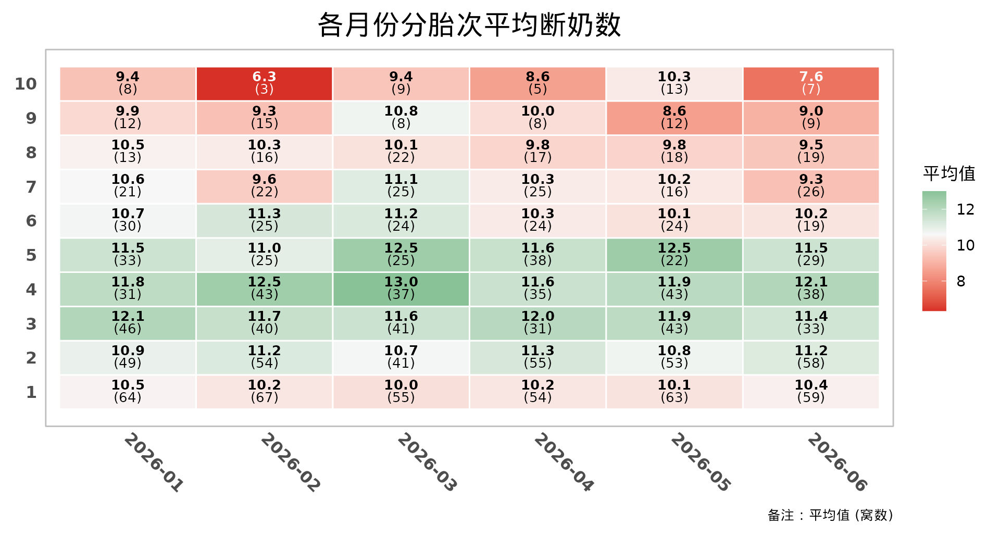
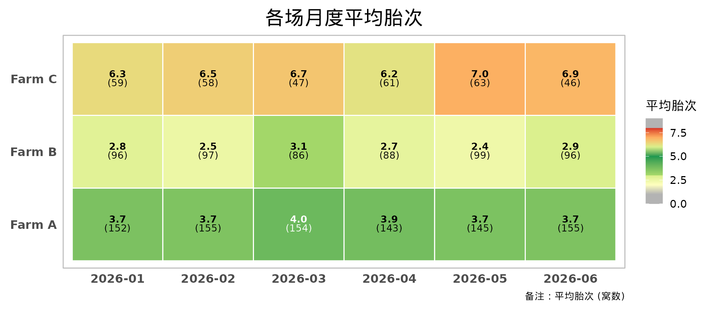
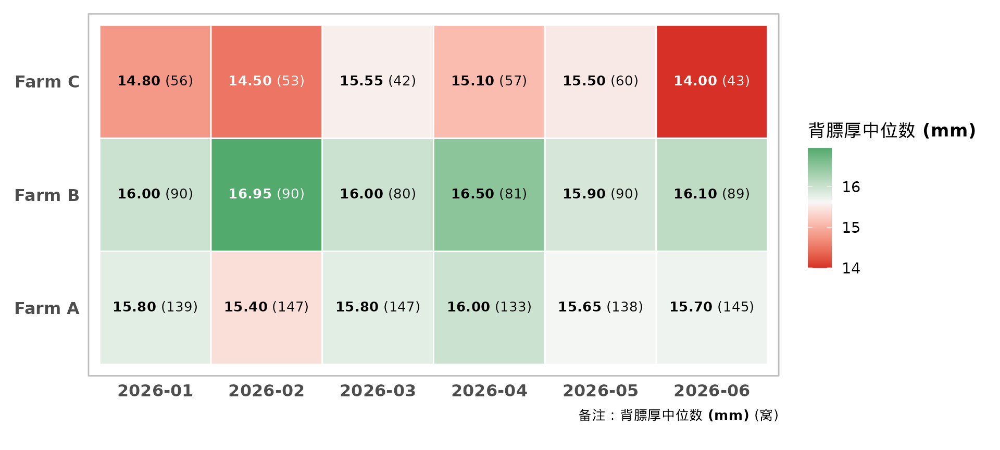
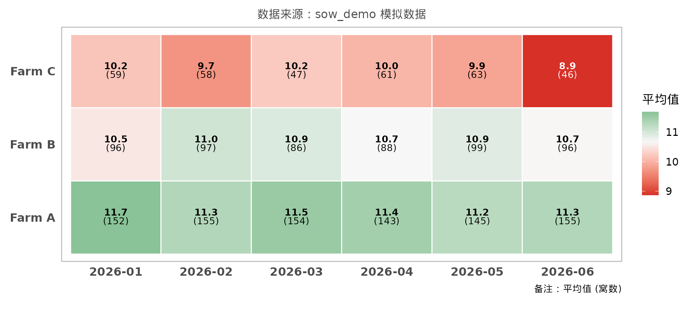

# 快速上手

``` r

library(pigheatmap)
```

pigheatmap 把”按胎次 ×
月份（或场区、品系……）汇总某项生产指标，再画成带数值标注的热图”
这件事封装成一个函数。本文用包内的模拟数据 `sow_demo` 演示主要用法。

``` r

head(sow_demo)
#>     month   farm parity born_alive weaned backfat
#> 1 2026-01 Farm A      1         13     13      NA
#> 2 2026-01 Farm A      1         15     14    17.2
#> 3 2026-01 Farm A      1         12     10    16.0
#> 4 2026-01 Farm A      1         11     11    19.4
#> 5 2026-01 Farm A      1         11     10    15.1
#> 6 2026-01 Farm A      1          9      9    15.8
```

## 汇总数据：summarise_heatmap_data()

[`summarise_heatmap_data()`](https://tony2015116.github.io/pigheatmap/reference/summarise_heatmap_data.md)
按 X × Y（以及可选的分面变量）分组，计算每个格子的统计值 `stat_value`
和有效样本数 `count`。它是
[`plot_performance_heatmap()`](https://tony2015116.github.io/pigheatmap/reference/plot_performance_heatmap.md)
的第一步，单独导出 方便拿到汇总表另作他用，比如导出到 Excel 或写进报告。

``` r

# 各场、各胎次的平均断奶数
summarise_heatmap_data(sow_demo, x_var = "farm", y_var = "parity", fill_var = "weaned")
#> # A tibble: 30 × 4
#>    farm   parity stat_value count
#>    <chr>   <int>      <dbl> <int>
#>  1 Farm A      1      10.6    173
#>  2 Farm A      2      11.4    147
#>  3 Farm A      3      11.8    131
#>  4 Farm A      4      12.4    144
#>  5 Farm A      5      12.3    108
#>  6 Farm A      6      11.2     69
#>  7 Farm A      7      10.8     66
#>  8 Farm A      8      10.4     43
#>  9 Farm A      9      10.1     16
#> 10 Farm A     10       9.14     7
#> # ℹ 20 more rows

# 用中位数，并剔除样本数少于 10 窝的格子
summarise_heatmap_data(
  sow_demo, "farm", "parity", "weaned",
  summary_stat = "median", min_count = 10
)
#> # A tibble: 25 × 4
#>    farm   parity stat_value count
#>    <chr>   <int>      <dbl> <int>
#>  1 Farm A      1         11   173
#>  2 Farm A      2         12   147
#>  3 Farm A      3         12   131
#>  4 Farm A      4         12   144
#>  5 Farm A      5         12   108
#>  6 Farm A      6         11    69
#>  7 Farm A      7         11    66
#>  8 Farm A      8         10    43
#>  9 Farm A      9         10    16
#> 10 Farm B      1         10   181
#> # ℹ 15 more rows
```

## 绘制热图：plot_performance_heatmap()

[`plot_performance_heatmap()`](https://tony2015116.github.io/pigheatmap/reference/plot_performance_heatmap.md)
在汇总的基础上完成绘图：格子里用富文本标注统计值和样本数，
颜色映射有三种模式（`plot_type`）：

- `"general"`（默认）：红-白-绿双向渐变，中间值默认为统计值的均值；
- `"parity"`：内置的胎次分段色阶，按**胎次数值**着色（3~5
  胎绿色、两端灰色）， 用于 `fill_var`
  本身就是胎次的场景，例如看各场、各月的平均胎次（胎龄结构）， 详见
  [`vignette("segmented-scales")`](https://tony2015116.github.io/pigheatmap/articles/segmented-scales.md)；
- `"segmented"`：自定义分段色阶，适合背膘厚、首配日龄等有经验最优区间的性状。

最简单的用法只需要指定数据、X、Y 和要汇总的指标：

``` r

# 通用红-白-绿渐变：各场、各胎次的平均断奶数
plot_performance_heatmap(
  sow_demo,
  x_var = "farm", y_var = "parity", fill_var = "weaned",
  y_axis_type = "parity",
  x_lab = "Farm", y_lab = "Parity"
)
```



``` r


# 按场分面 + 按样本量调节透明度（高胎次窝数少，格子更透明）
plot_performance_heatmap(
  sow_demo,
  x_var = "month", y_var = "parity", fill_var = "born_alive",
  facet_vars = "farm",
  y_axis_type = "parity",
  alpha_by_count = TRUE,
  theme_args = list(x_axis_angle = -45, strip_text_size = 14)
)
```



``` r


# 胎次分段配色：各场、各月的平均胎次（3~5 胎为绿色，偏低为黄色，偏高为橙红色）
plot_performance_heatmap(
  sow_demo,
  x_var = "month", y_var = "farm", fill_var = "parity",
  plot_type = "parity",
  fill_lab = "Mean parity",
  theme_args = list(x_axis_angle = 0)
)
```



### 中文列名与胎次自动识别

实际数据里的列名通常是中文。`y_axis_type` 默认为 `"auto"`：只要列名匹配
`auto_detect_pattern`（默认为”胎次”），就会自动使用从 1
开始的整数刻度，不必手动指定。

``` r

sow_cn <- data.frame(
  "年月" = sow_demo$month,
  "场区" = sow_demo$farm,
  "胎次" = sow_demo$parity,
  "断奶数" = sow_demo$weaned,
  check.names = FALSE
)

plot_performance_heatmap(
  sow_cn,
  x_var = "年月", y_var = "胎次", fill_var = "断奶数",
  title = "各月份分胎次平均断奶数"
)
```



用胎次色阶看各场的胎龄结构：

``` r

plot_performance_heatmap(
  sow_cn,
  x_var = "年月", y_var = "场区", fill_var = "胎次",
  plot_type = "parity",
  fill_lab = "平均胎次",
  title = "各场月度平均胎次",
  theme_args = list(x_axis_angle = 0)
)
```



### 统计量、样本量阈值与格子标签

``` r

plot_performance_heatmap(
  sow_demo,
  x_var = "month", y_var = "farm", fill_var = "backfat",
  summary_stat = "median",   # 也可以是 "sd"、"max" 或自定义函数
  min_count = 30,            # 少于 30 窝的格子不显示
  text_layout = "h",         # 数值和样本数放在同一行
  label_digits = 2,
  count_label = "窝",
  fill_lab = "背膘厚中位数 (mm)",
  theme_args = list(x_axis_angle = 0)
)
```



### 继续用 ggplot2 修改

返回值是普通的 ggplot 对象，可以继续叠加图层或主题；汇总数据保存在
`p$data` 中。

``` r

p <- plot_performance_heatmap(
  sow_demo, "month", "farm", "weaned",
  theme_args = list(x_axis_angle = 0)
)
p + ggplot2::labs(subtitle = "数据来源：sow_demo 模拟数据")
```



``` r

head(p$data)
#> # A tibble: 6 × 7
#>   month   farm   stat_value count label_text           .alpha .label_color
#>   <chr>   <chr>       <dbl> <int> <chr>                 <dbl> <chr>       
#> 1 2026-01 Farm A      11.7    152 <b>11.7</b><br>(152)      1 black       
#> 2 2026-01 Farm B      10.5     96 <b>10.5</b><br>(96)       1 black       
#> 3 2026-01 Farm C      10.2     59 <b>10.2</b><br>(59)       1 black       
#> 4 2026-02 Farm A      11.3    155 <b>11.3</b><br>(155)      1 black       
#> 5 2026-02 Farm B      11.0     97 <b>11.0</b><br>(97)       1 black       
#> 6 2026-02 Farm C       9.71    58 <b>9.7</b><br>(58)        1 black
```

### 导出图片

导出含中文的图片前，先调用一次
[`enable_cn_font()`](https://tony2015116.github.io/pigheatmap/reference/enable_cn_font.md)，并让
`dpi` 与
[`ggsave()`](https://ggplot2.tidyverse.org/reference/ggsave.html) 一致，
详见
[`vignette("theme-and-fonts")`](https://tony2015116.github.io/pigheatmap/articles/theme-and-fonts.md)。

``` r

enable_cn_font(dpi = 300)
ggplot2::ggsave("heatmap.png", p, width = 12, height = 7, dpi = 300)
```
