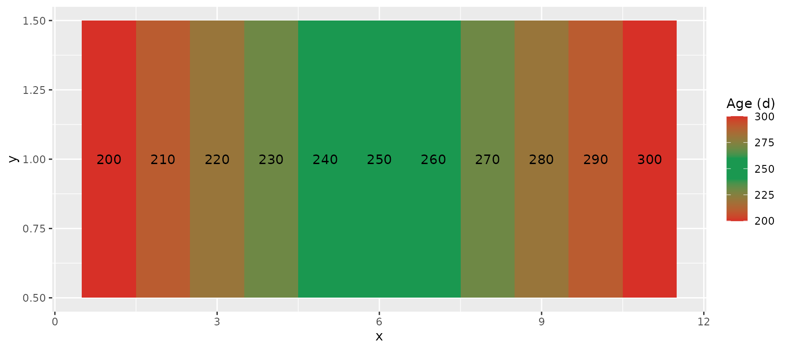
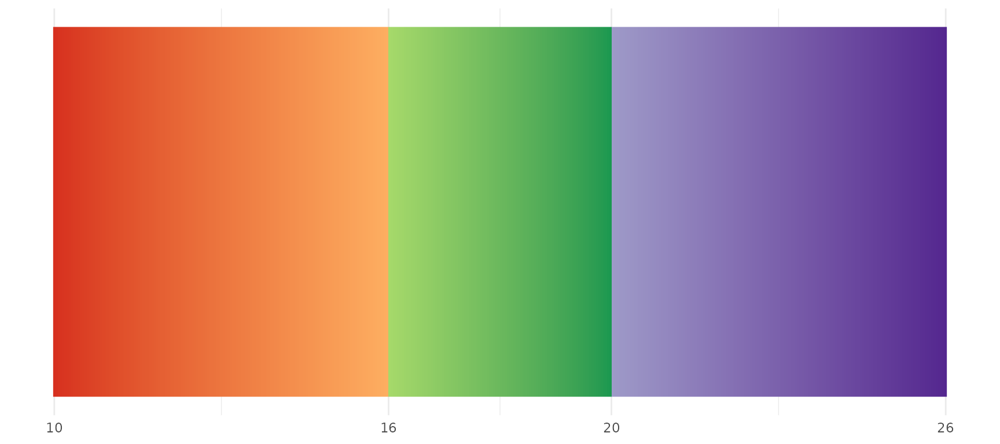
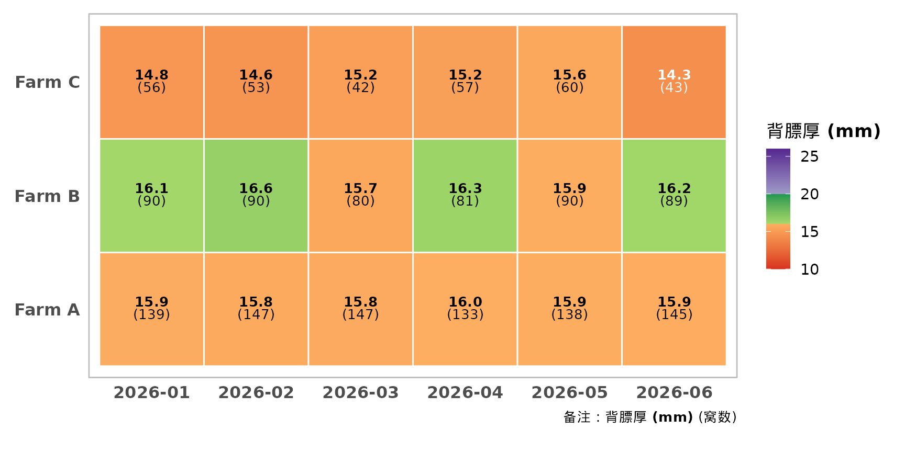
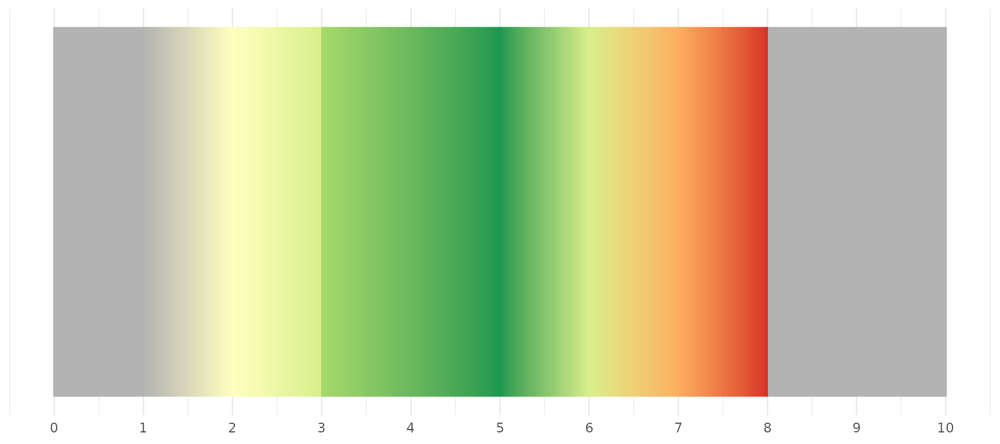
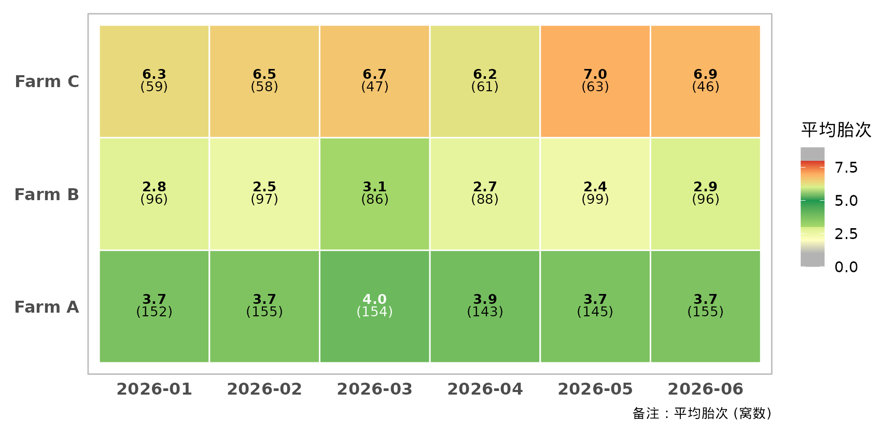
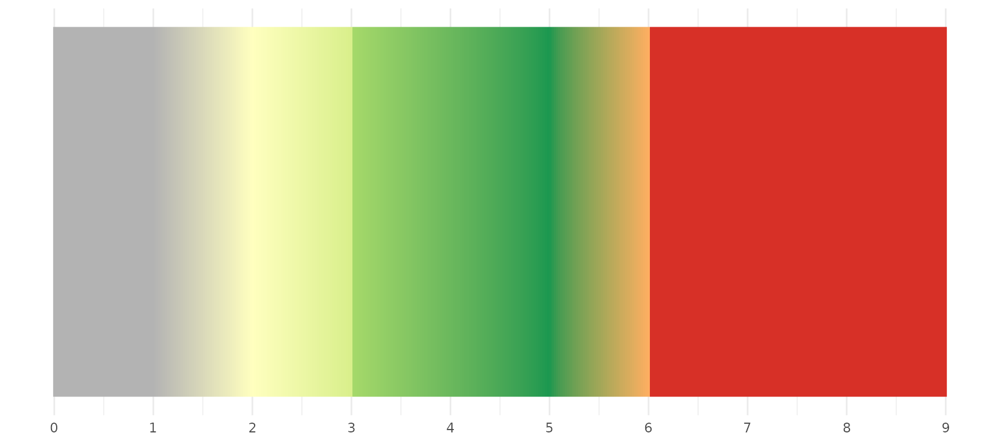

# 分段色阶

``` r

library(pigheatmap)
```

很多生产性状都有经验上的”最优区间”：3~5 胎是生产高峰，首配日龄 240~260
天最合适，
背膘厚太薄太厚都不好。普通的双色渐变表达不了这种”区间对应颜色”的含义，
[`build_segment_scale()`](https://tony2015116.github.io/pigheatmap/reference/build_segment_scale.md)
就是为此设计的。

``` r

library(ggplot2)

# 画一条色带，直观展示色阶在整个取值范围内的颜色
show_scale <- function(scale, from, to) {
  d <- data.frame(x = seq(from, to, length.out = 400), y = 1)
  ggplot(d, aes(x, y, fill = x)) +
    geom_raster() +
    scale +
    scale_y_continuous(breaks = NULL) +
    labs(x = NULL, y = NULL) +
    theme_minimal() +
    theme(legend.position = "none")
}
```

## 构造分段色阶：build_segment_scale()

断点表 `stops` 是一个两列数据框：`value` 为断点位置，`color`
为该位置的颜色， 相邻断点之间线性渐变。

例如首配日龄：240~260 天为最优区间（绿色），向两侧逐渐变红。

``` r

library(ggplot2)

mating_age_stops <- data.frame(
  value = c(200, 240, 260, 300),
  color = c("#D73027", "#1A9850", "#1A9850", "#D73027")
)

df <- data.frame(x = 1:11, y = 1, age = seq(200, 300, by = 10))
ggplot(df, aes(x, y, fill = age)) +
  geom_tile() +
  geom_text(aes(label = age)) +
  build_segment_scale(mating_age_stops, name = "Age (d)")
```



### 硬分界

同一个 `value`
出现两次、颜色不同，就得到一条清晰的分界线，而不是渐变。下面是背膘厚的例子：
16 mm 以下按”偏瘦”着橙色，16~20 mm 为理想区间（绿色），20 mm
以上为”偏肥”（紫色）。

``` r

backfat_stops <- data.frame(
  value = c(10, 16, 16, 20, 20, 26),
  color = c("#D7301F", "#FDAE61", "#A6D96A", "#1A9850", "#9E9AC8", "#54278F")
)
show_scale(build_segment_scale(backfat_stops), 10, 26) +
  scale_x_continuous(breaks = c(10, 16, 20, 26))
```



把这个色阶用到热图里，只需要 `plot_type = "segmented"` 加上
`color_stops`：

``` r

plot_performance_heatmap(
  sow_demo,
  x_var = "month", y_var = "farm", fill_var = "backfat",
  plot_type = "segmented", color_stops = backfat_stops,
  fill_lab = "背膘厚 (mm)",
  theme_args = list(x_axis_angle = 0)
)
```



## 内置胎次色阶：default_parity_stops()

`plot_type = "parity"`
时默认使用这套配色：两端代表性不足的胎次为灰色，3~5 胎生产高峰为深绿，
之后依次经过黄绿、橙、红，颜色越醒目表示下降越明显。

注意色阶的断点是**胎次数值**，所以它是给”胎次”本身着色的，典型用法是看各场、各月的
平均胎次，判断胎龄结构是否合理。产仔数、断奶数等指标的数值范围完全不同，
请用 `plot_type = "general"` 或自定义的 `"segmented"` 色阶。

``` r

default_parity_stops()
#>    value   color
#> 1      0  grey70
#> 2      1  grey70
#> 3      2 #FFFFBF
#> 4      3 #D9EF8B
#> 5      3 #A6D96A
#> 6      5 #1A9850
#> 7      6 #D9EF8B
#> 8      7 #FDAE61
#> 9      8 #D73027
#> 10     8  grey70
#> 11     9  grey70
```

把它画成色带：

``` r

show_scale(build_segment_scale(default_parity_stops()), 0, 10) +
  scale_x_continuous(breaks = 0:10)
```



用在热图里：示例数据中 Farm B 以低胎次为主（黄色），Farm C
高胎次母猪偏多（橙色）。

``` r

plot_performance_heatmap(
  sow_demo,
  x_var = "month", y_var = "farm", fill_var = "parity",
  plot_type = "parity",
  fill_lab = "平均胎次",
  theme_args = list(x_axis_angle = 0)
)
```



如果你的场把 6 胎以上就视为需要淘汰，可以在默认方案的基础上修改断点：

``` r

my_parity_stops <- data.frame(
  value = c(0, 1, 2, 3, 3, 5, 6, 6, 9),
  color = c("grey70", "grey70", "#FFFFBF", "#D9EF8B", "#A6D96A", "#1A9850",
            "#FDAE61", "#D73027", "#D73027")
)
show_scale(build_segment_scale(my_parity_stops), 0, 9) +
  scale_x_continuous(breaks = 0:9)
```


