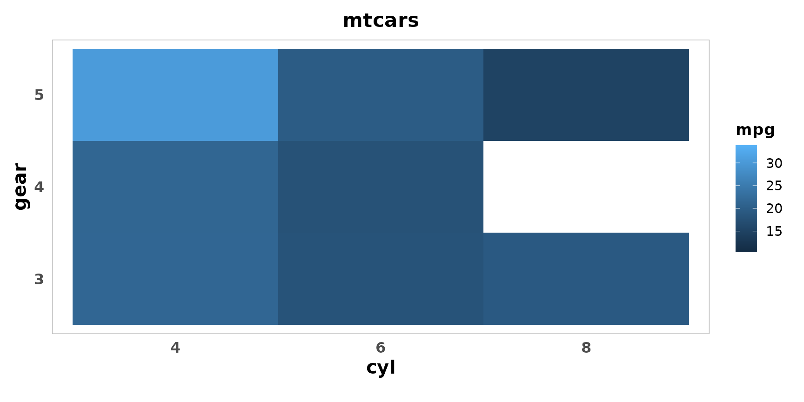
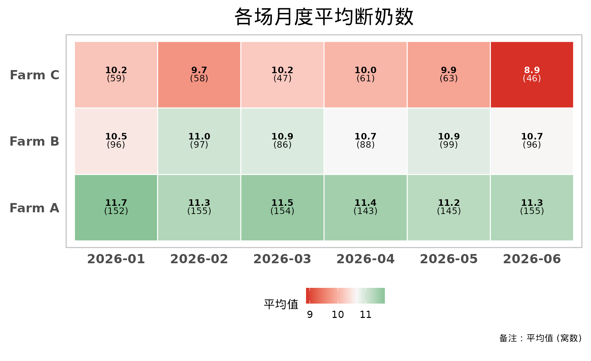

# 主题与中文字体

``` r

library(pigheatmap)
```

``` r

library(ggplot2)
```

## 统一主题：get_common_theme()

[`get_common_theme()`](https://tony2015116.github.io/pigheatmap/reference/get_common_theme.md)
是热图使用的统一主题：标题加粗居中、去掉网格线、分面标题灰底、
说明文字支持 HTML/Markdown。在
[`plot_performance_heatmap()`](https://tony2015116.github.io/pigheatmap/reference/plot_performance_heatmap.md)
中通过 `theme_args` 传参调整；它本身也可以叠加到任何 ggplot
上，让同一份报告里的图风格统一。

``` r

library(ggplot2)
ggplot(mtcars, aes(factor(cyl), factor(gear), fill = mpg)) +
  geom_tile() +
  labs(title = "mtcars", x = "cyl", y = "gear") +
  get_common_theme(x_axis_angle = 0, title_size = 16)
```



### 在热图中调整主题

[`get_common_theme()`](https://tony2015116.github.io/pigheatmap/reference/get_common_theme.md)
的所有参数都可以放进 `theme_args` 传给
[`plot_performance_heatmap()`](https://tony2015116.github.io/pigheatmap/reference/plot_performance_heatmap.md)。
比如投屏时把字号整体调大、横排 X 轴文字、把图例放到下方：

``` r

plot_performance_heatmap(
  sow_demo, "month", "farm", "weaned",
  title = "各场月度平均断奶数",
  theme_args = list(
    base_size = 16,
    title_size = 22,
    axis_text_size = 14,
    x_axis_angle = 0,
    legend_position = "bottom"
  )
)
```



拼写错误的参数会直接报错，而不是被悄悄忽略：

``` r

plot_performance_heatmap(
  sow_demo, "month", "farm", "weaned",
  theme_args = list(axis_txt_size = 14)
)
#> Error:
#> ! `theme_args` 中有 get_common_theme() 不支持的参数：axis_txt_size
```

## 中文字体：enable_cn_font()

在 RStudio 里预览图片时中文通常显示正常，但用
[`ggsave()`](https://ggplot2.tidyverse.org/reference/ggsave.html) 导出
PNG、或在没有中文字体的
服务器上运行时，中文可能变成方框。[`enable_cn_font()`](https://tony2015116.github.io/pigheatmap/reference/enable_cn_font.md)
调用 showtext 解决这个问题。

**注意 dpi 必须和导出时一致**：showtext 默认按 96 dpi 渲染文字，如果用
`ggsave(dpi = 300)` 导出而这里没有设成 300，图片中的文字会明显偏小。

``` r

#' \dontrun{
# 脚本开头调用一次
enable_cn_font(dpi = 300)

p <- plot_performance_heatmap(sow_demo, "month", "parity", "weaned")
ggplot2::ggsave("heatmap.png", p, width = 12, height = 7, dpi = 300)

# 使用指定的字体文件（例如 Windows 上的微软雅黑）
enable_cn_font(dpi = 300, family = "C:/Windows/Fonts/msyh.ttc")
p + ggplot2::theme(text = ggplot2::element_text(family = "cn"))
#' }
```
