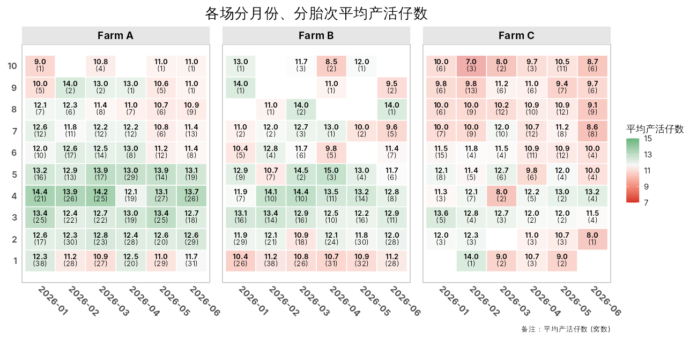

# pigheatmap

猪场生产数据的性能热图工具：按胎次 ×
月份（或场区、品系……）汇总生产指标， 画成带数值和样本数标注的热图。

- **自动聚合**：均值、中位数、标准差……也可以传入自定义函数
- **分段色阶**：胎次、背膘厚、首配日龄等有经验最优区间的性状，用颜色直接标出”好/坏”区间
- **样本量提示**：格子显示窝数，还可以按样本量调节透明度，一眼看出哪些结果不可靠
- **中文友好**：中文列名、中文标签开箱即用，[`enable_cn_font()`](https://tony2015116.github.io/pigheatmap/reference/enable_cn_font.md)
  解决导出图片的中文显示

## 安装

``` r

# install.packages("remotes")
remotes::install_github("tony2015116/pigheatmap")

# 导出含中文的图片时需要
install.packages("showtext")
```

## 示例

``` r

library(pigheatmap)

plot_performance_heatmap(
  sow_demo,
  x_var = "month", y_var = "parity", fill_var = "born_alive",
  facet_vars = "farm",
  y_axis_type = "parity",
  alpha_by_count = TRUE,
  fill_lab = "平均产活仔数",
  title = "各场分月份、分胎次平均产活仔数"
)
```



各场分月份、分胎次的平均产活仔数

更多用法见网站上的文章：

- [快速上手](https://tony2015116.github.io/pigheatmap/articles/pigheatmap.html)
- [分段色阶](https://tony2015116.github.io/pigheatmap/articles/segmented-scales.html)
- [主题与中文字体](https://tony2015116.github.io/pigheatmap/articles/theme-and-fonts.html)

## 开发

本包使用 [fusen](https://thinkr-open.github.io/fusen/)
开发，**所有代码、文档、测试和文章都写在 `dev/flat_*.Rmd`
中**，`R/`、`tests/testthat/test-*.R`、`vignettes/`
都是生成的，不要直接修改。

``` r

# 修改 dev/flat_*.Rmd 之后
source("dev/inflate_all.R")   # 重新生成整个包
devtools::check()
pkgdown::build_site()         # 本地预览网站
```

完整的开发流程见 `dev/0-dev_history.Rmd`。推送到 GitHub 后，GitHub
Actions 会自动运行 R CMD check，并构建网站发布到 GitHub Pages。
